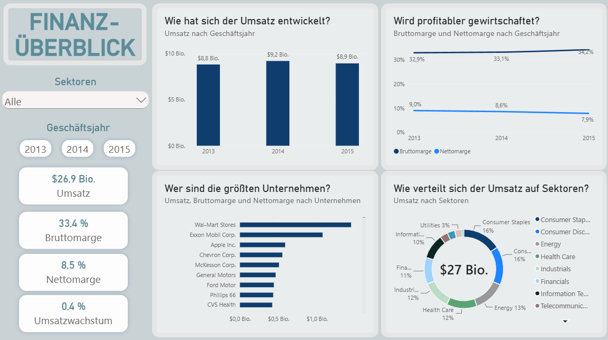
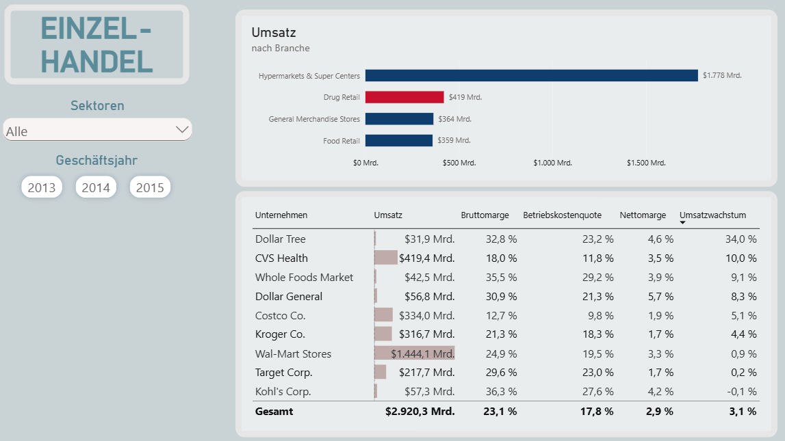
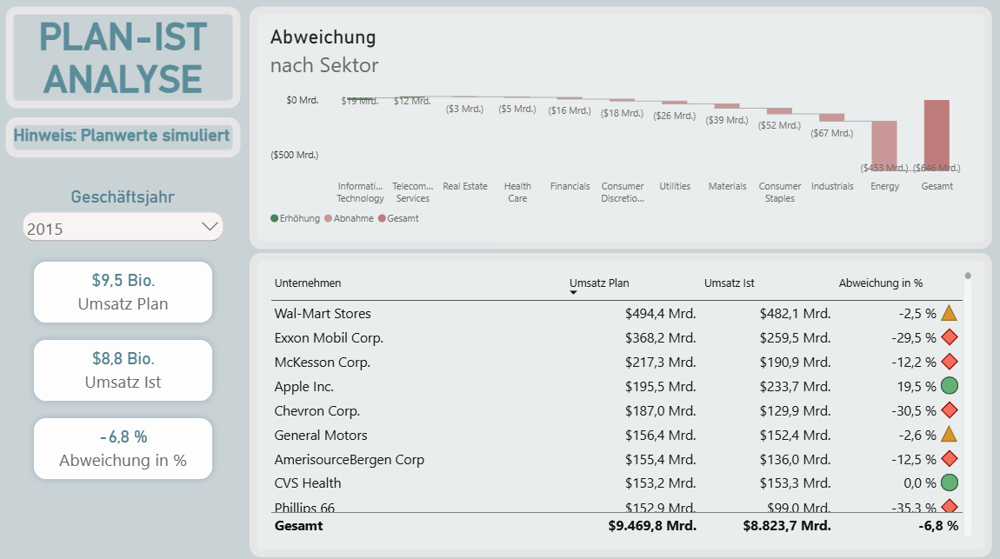

# Finance Analytics Dashboard

Portfolio-Projekt: Aufbereitung von Finanzkennzahlen der S&P-500-Unternehmen mit Python,
Modellierung in einem SQL-Star-Schema und Visualisierung in Power BI, inklusive
Plan-Ist-Vergleich und Peer-Analyse im Einzelhandel.

**Tools:** Python (pandas, SQLAlchemy) · SQL (SQLite) · Power BI (DAX) · uv · Git

## Dashboard

Power-BI-Bericht: [`powerbi/finance_dashboard.pbix`](powerbi/finance_dashboard.pbix)

### 1. Finanzüberblick
Umsatzentwicklung, Margen, größte Unternehmen und Umsatzverteilung nach Sektor (GJ 2013–2015).



### 2. Einzelhandel
Peer-Vergleich von neun US-Händlern: Bruttomarge, Betriebskostenquote, Nettomarge und Wachstum.



### 3. Plan-Ist-Analyse
Abweichungsanalyse nach Sektor (Wasserfall) und Unternehmen (Ampellogik).
2015 lag der Umsatz 6,8 % unter Plan, rund zwei Drittel davon entfallen auf den
Energiesektor (Ölpreisverfall).



> Die Planwerte sind **simuliert** und keine echten Unternehmensplanungen:
> Planumsatz = Vorjahresumsatz × (1 + Ø-Wachstum der letzten bis zu 3 Jahre, gekappt auf −20 %…+30 %),
> Kosten und Ergebnis über die Vorjahresquoten.

## Datenquelle

Kaggle-Datensatz **„New York Stock Exchange“** (S&P-500-Fundamentaldaten 2012–2016):
https://www.kaggle.com/datasets/dgawlik/nyse

Benötigt werden diese Dateien in `data/raw/`:

| Datei | Inhalt | Im Repo |
|---|---|---|
| `fundamentals.csv` | Jahresabschlusskennzahlen je Unternehmen und Jahr | ja |
| `securities.csv` | Stammdaten: Name, GICS-Sektor, Branche | ja |
| `prices.csv`, `prices-split-adjusted.csv` | tägliche Aktienkurse | nein (je ~50 MB, im Projekt nicht genutzt) |

## Setup und Ausführung

Voraussetzung: [uv](https://docs.astral.sh/uv/) ist installiert.

```bash
uv sync                              # Abhängigkeiten installieren
uv run python src/run_pipeline.py    # komplette Pipeline ausführen
```

Die Pipeline erzeugt alle Dateien in `data/processed/` sowie die SQLite-Datenbank
`data/processed/finance.db`. Diese Dateien sind nicht versioniert, da sie jederzeit
neu erzeugt werden können. Jeder Lauf wird in `logs/pipeline.log` protokolliert.

## Pipeline

```
data/raw/fundamentals.csv + securities.csv
   │
   ├─ 1. src/clean.py       Bereinigung       -> fundamentals_clean.csv
   ├─ 2. src/transform.py   Kennzahlen        -> fundamentals_enriched.csv
   ├─ 3. src/plan.py        Planwerte         -> plan.csv
   └─ 4. src/load_to_db.py  Laden (SQLite)    -> finance.db + CSV-Exporte für Power BI
                                                 (Schema: sql/schema.sql)
```

Die explorative Analyse der Rohdaten liegt in
[`src/finance_analytics_dashboard/explore.ipynb`](src/finance_analytics_dashboard/explore.ipynb).

## Datenmodell

Star-Schema mit einer Dimension und zwei Faktentabellen (je Unternehmen und Geschäftsjahr):

```
                 1 ──< n  fact_financials   (Ist-Werte)
   dim_company
                 1 ──< n  fact_plan         (Planwerte)

   v_plan_vs_actual: View mit fertig berechneten Plan-Ist-Abweichungen
```

## Datenqualität: Entscheidungen

| Befund | Entscheidung |
|---|---|
| Spalte `For Year` lückenhaft (173 fehlend), Fehlwert „1215“, doppelte Jahre | Geschäftsjahr aus `Period Ending` abgeleitet (Jahresende Jan–Mai → Vorjahr) |
| Vereinzelte, unplausible Abschlüsse 2003–2007 (COTY) | entfernt |
| Banken/Versicherer ohne Herstellkosten (`Cost of Revenue = 0`) | Kostenquote und Bruttomarge als „nicht anwendbar“ (leer) statt 0 % bzw. 100 % |
| CVS: SG&A in den Quelldaten mit 0 erfasst | Betriebskostenquote stattdessen als (Bruttogewinn − operatives Ergebnis) / Umsatz |
| 2012 und 2016 nur teilweise im Datensatz enthalten | Zeitvergleiche im Dashboard auf 2013–2015 begrenzt |
| Fehlende Liquiditätskennzahlen, EPS | bleiben leer, keine Schätzung von Finanzwerten |

## Kennzahlen

| Kennzahl | Formel |
|---|---|
| Kostenquote | Herstellkosten / Umsatz |
| Bruttomarge | Bruttogewinn / Umsatz (gewichtet über alle ausgewählten Unternehmen) |
| Betriebskostenquote | (Bruttogewinn − operatives Ergebnis) / Umsatz |
| Nettomarge | Jahresüberschuss / Umsatz |
| Umsatzwachstum | Veränderung zum direkten Vorjahr, nur bei lückenlosen Jahren |
| Plan-Ist-Abweichung | Ist − Plan, absolut und in % des Plans |
